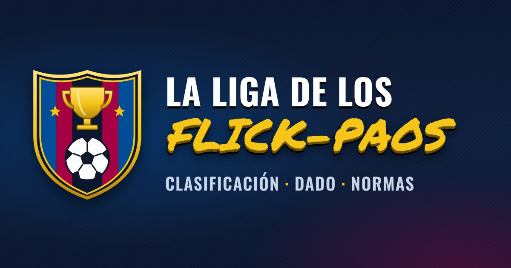
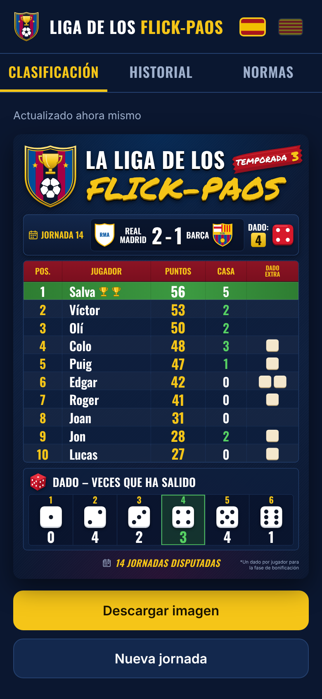
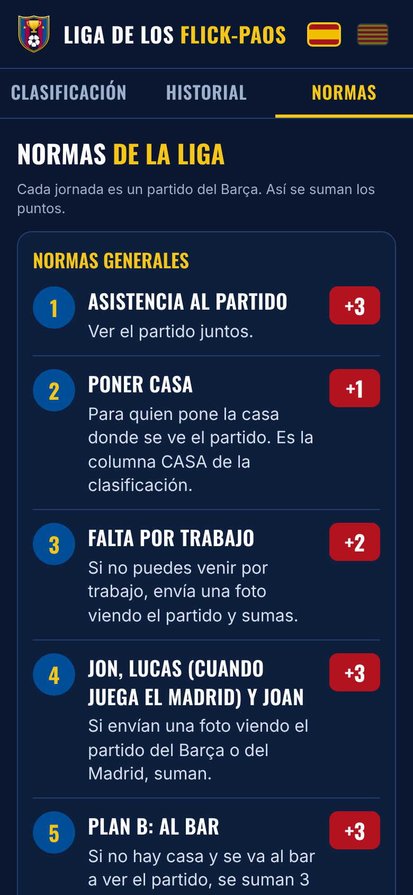

<div align="center">

<a href="https://joancomasfdz.github.io/flick-paos/"></a>

# La Liga de los Flick-Paos

**Friends, Barça matches, a die and a league table that never gets the numbers wrong.**

### 👉 [joancomasfdz.github.io/flick-paos](https://joancomasfdz.github.io/flick-paos/) 👈

[](https://joancomasfdz.github.io/flick-paos/)
[](js/)
[](#-run-locally)
[](code.gs)

&nbsp;&nbsp;&nbsp;

</div>

---

## ⚽ What is this?

A group of friends watches every FC Barcelona match together, rolls a die and earns points by the house rules. After every match someone posts the standings image to the WhatsApp group.

That image used to be made by an AI image generator editing the previous one, so it got blurrier every week and the numbers and rankings came out wrong. This site computes the table instead and draws the image in code, so it's sharp and always adds up.

## ✨ Features

- 🏆 **Live standings**: points, CASA, extra dice and the dice counter, worked out from every jornada.
- 📈 **▲/▼ arrows**: how many places each player went up or down since the previous jornada.
- 🕰️ **Historial**: every jornada has its own table, the way it stood after that match, with ‹ › to move between them.
- 📸 **One-tap image**: download the 1080×1620 scoreboard or share it straight to WhatsApp.
- 📝 **Phone-friendly form**: the scorekeeper adds or edits a jornada with a live preview, protected by the group's PIN. No accounts.
- 📜 **Normas**: the league's rules, always at hand.
- 🌍 **Castellano and Català**: tap a flag in the top bar.

## 🧱 How it works

```
Google Sheet  ⇄  Apps Script web app (code.gs)  ⇄  static page on GitHub Pages
   the data         read + PIN-protected writes        computes the table, draws the card
```

Plain HTML, CSS and ES modules: no framework, no build step. The full spec is in [SPEC.md](SPEC.md).

## 🛠️ Setup

1. **Backend.** Create a Google Sheet, open *Extensions → Apps Script*, paste [code.gs](code.gs) and run `setup()` once. In *Project Settings → Script Properties* set `PIN` (the group's shared PIN) and `CURRENT_SEASON` (e.g. `3`). Deploy as a web app: *Execute as: Me*, *Who has access: Anyone*.
2. **API URL.** Put the web app URL in [js/config.js](js/config.js) (`API_URL`). It is the only configuration; the PIN is never stored in the repo.
   After changing `code.gs` later, paste it again, run `setup()` once (it adds any new column headers and keeps the data) and publish a new version: *Deploy → Manage deployments → Edit → Version: New version*, so the URL stays the same.
3. **Publish.** GitHub → *Settings → Pages → Deploy from a branch*, branch `main`, folder `/`.

## 💻 Run locally

```bash
python3 -m http.server 8000     # or: npx serve
```

Open <http://localhost:8000/>. With <http://localhost:8000/?mock=1> the page uses [mock-data.json](mock-data.json) (the table after jornada 14) instead of the API; writes stay in memory and the PIN is `1234`.

Tests (Node 20+, no dependencies):

```bash
node --test
```

## 📝 How the scorekeeper adds a matchday

1. Open the page on the phone and tap **Nueva jornada**. The first time, the page asks for the group's PIN and remembers it on that phone.
2. The jornada number and today's date are filled in. Search the rival (LaLiga and Champions League teams are listed; any other, like a Copa del Rey team, can be typed and used), *En casa* / *Fuera*, the goals and tap the die that came out.
3. For each player set the points of the matchday (− / +, can be negative), and *Casa*. If you were 5 or more, pick who rolled the extra die (the last in the table among those watching) and what it showed: its face is added to their points. The **Vista previa** at the bottom shows the resulting table.
4. Tap **Guardar**. If the PIN has changed since, the page asks for the new one.
5. Back on the scoreboard, tap **Compartir** (sends the image straight to WhatsApp) or **Descargar imagen**.

To fix a matchday: **Historial** → tap it → **Editar jornada N** → change it and save, or **Borrar jornada**.

### Starting from an existing table (Totales acumulados)

To start from totals instead of the full history (e.g. the table after jornada 14), tap **Avanzado** → **Totales acumulados**: enter each player's *total* points and casa, the extra dice each one has won (with their faces), and how many times each die face has come out. The match fields are optional and only show in the header; it never counts as a die roll. Matches added after it add on top. To correct it later, open it from **Historial**: **Nueva jornada** never overwrites a jornada that already exists, it offers to edit it instead.

## ⚖️ Changing the rules

Every scoring and ranking rule is in [js/rules.js](js/rules.js), one documented function or constant each:

| Rule | Where |
|---|---|
| Total points | `totalPoints` |
| CASA column, and when it is green | `casaTotal`, `isCasaHighlighted` |
| Points of a matchday, extra die included | `scorePoints` |
| DADO EXTRA column | `extraDiceWon`, `EXTRA_DIE_MIN_WATCHERS` |
| Ranking and tiebreaks | `compareStandings`, `isTie` |
| Shared positions on ties (1, 2, 2, 4) | `SHARED_POSITIONS_ON_TIE` |
| Dice counter | `diceCounts` |
| Jornadas played, header matchday | `jornadasPlayed`, `lastMatchday` |
| ▲/▼ position change since the previous jornada | `positionChange` |

Change the rule there, update its test in [tests/standings.test.js](tests/standings.test.js) and run `node --test`.

## 🗂️ Files

| File | What |
|---|---|
| `index.html`, `css/styles.css` | The page and the 1080×1620 card styles |
| `js/config.js` | `API_URL` |
| `js/api.js` | Backend calls, and the `?mock=1` backend |
| `js/rules.js`, `js/standings.js` | Pure rules and the standings view model |
| `js/render.js`, `js/icons.js` | The card's DOM and its inline SVG artwork |
| `js/form.js` | Add / edit matchday form with live preview |
| `js/export.js` | PNG export (html-to-image) and sharing |
| `js/i18n.js` | Spanish and Catalan texts (flags in the top bar; the choice is remembered per phone) |
| `js/teams.js` | Barça's possible rivals (LaLiga and Champions League 2026-27) for the rival search and the badges. Update the `comps` of each team every season |
| `js/normas.js` | The league's rules, shown in the *Normas* tab, in Spanish and Catalan |
| `js/app.js` | Routing (`#/`, `#/jornada/new`, `#/jornada/{n}`, `#/historial`, `#/historial/{n}`, `#/normas`), cache, PIN |
| `assets/crest.svg` | League crest |
| `assets/*.png`, `assets/og-image.jpg`, `manifest.webmanifest` | Icons and the link preview, made from the crest and `tools/share-image.html` by `node tools/render-images.cjs` (needs Playwright) |
| `code.gs` | The Apps Script backend |
| `docs/*.png` | Screenshots for this README |
